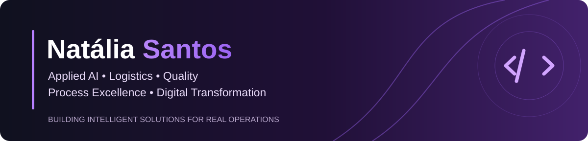

# Natália Santos
### Applied AI · Process Excellence · Digital Transformation

**Turning complex operational challenges into practical, human-centered intelligent solutions.**

---

## ✦ About me

I combine experience in **logistics, dangerous goods, quality and process governance** with **applied AI, analytics and automation**. I design practical solutions that simplify workflows, support decisions and keep human oversight where it matters.

> **My focus:** intelligent operations, reliable workflows, continuous improvement and measurable business value.

## ✦ Featured projects

<table>
<tr>
<td width="50%" valign="top">

### [01 · DocManager](https://github.com/natgeo1997/docmanager)
**AI-assisted document management**

Document editing, version comparison and AI-assisted change summaries with human review.

**Stack:** React · JavaScript · FastAPI · Python · OpenAI API

[Explore repository](https://github.com/natgeo1997/docmanager) · [Try demo](https://natalia-practical-ai-demos.natygeo.chatgpt.site/docmanager/index.html)

</td>
<td width="50%" valign="top">

### [02 · LogiOps AI](https://github.com/natgeo1997/logiops-ai)
**Intelligent logistics incident assessment**

AI-assisted structured incident analysis, priorities, possible causes and recommended actions for professional review.

**Stack:** Python · Streamlit · Gemini API · Pydantic

[Explore repository](https://github.com/natgeo1997/logiops-ai) · [Try walkthrough](https://natalia-practical-ai-demos.natygeo.chatgpt.site/logiops/index.html) · [Watch demo](https://github.com/natgeo1997/logiops-ai/blob/main/logiops-ai-linkedin.mp4)

</td>
</tr>
<tr>
<td width="50%" valign="top">

### [03 · Water Quality Clustering](https://github.com/natgeo1997/water-quality-clustering)
**Machine learning and exploratory analytics**

Cleaning, scaling, K-Means clustering and PCA visualization of water-quality indicators.

**Stack:** Python · pandas · NumPy · scikit-learn · Matplotlib

[Explore repository](https://github.com/natgeo1997/water-quality-clustering)

</td>
<td width="50%" valign="top">

### [04 · SQL & Python Sales Analysis](https://github.com/natgeo1997/sql-python-sales-analysis)
**Business analytics and reporting**

Sales analysis by product category using SQL queries, Python processing and visual reporting.

**Stack:** SQL · SQLite · Python · pandas · Matplotlib

[Explore repository](https://github.com/natgeo1997/sql-python-sales-analysis)

</td>
</tr>
</table>

## ✦ Technology & capabilities

| Applied AI | Data & engineering | Process excellence |
| :--- | :--- | :--- |
| LLM integration, structured outputs, human-in-the-loop | Python, SQL, dashboards, APIs, automation | Quality, governance, logistics, continuous improvement |

## ✦ Engineering mindset

Both featured AI prototypes include **automated tests and GitHub Actions**. Their small synthetic evaluation suites help document behavior and limitations; they do **not** establish production accuracy or business impact.

[DocManager evaluation](https://github.com/natgeo1997/docmanager/tree/main/evaluation) · [LogiOps AI evaluation](https://github.com/natgeo1997/logiops-ai/tree/main/evaluation)

## ✦ Let's connect

I enjoy building at the intersection of **operations, data and intelligent systems**.

**[LinkedIn](https://www.linkedin.com/in/natalia-santos-1576953a2/)** · **[Email](mailto:nbezerra.engineer@gmail.com)** · **[Interactive demos](https://natalia-practical-ai-demos.natygeo.chatgpt.site)**

Portuguese (native) · English (advanced) · Spanish (learning)
